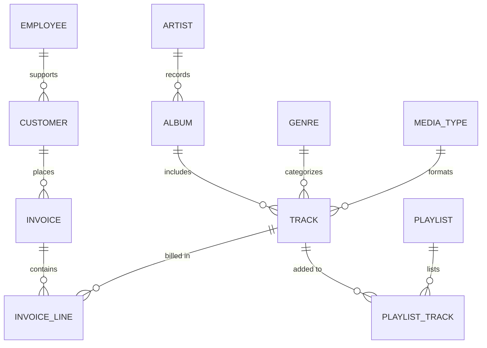

# Digital Music Store Database & Sales Analysis

[](https://www.postgresql.org/)
[-CC292B?style=flat&logo=mysql&logoColor=white)](https://en.wikipedia.org/wiki/SQL)
[](https://www.python.org/)
[](https://seaborn.pydata.org/)

An in-depth commercial and operational database analysis of a global digital music retail store (Chinook schema). This project solves business problems ranging from employee organizational hierarchy and regional festival planning to customer lifetime value (CLV), catalog popularity, and multi-country customer segmentation using advanced SQL and Python visualization pipelines.

---

## 📌 Business Questions & Key Insights

### 1. Seniority & Organization Structure
* **Senior-Most Employee:** Identified top leadership (`Madan Mohan`, Senior General Manager) reporting lines and organizational hierarchy by querying employee seniority tiers and manager mappings.

### 2. Geographic Revenue Concentration
* **Top Billing Countries:** The **United States, Canada, and Brazil** drive the highest invoice volume globally.
* **Music Festival Target Market:** **Prague (Czech Republic)** generated the single highest sum of invoice totals, identifying it as the prime market for hosting promotional music festivals.

### 3. Customer Lifetime Value (CLV)
* **Top Spender:** Identified highest-value customer accounts (e.g., `František Čerevený` / `Helena Holý`) to tailor VIP loyalty and retention programs.

### 4. Catalog & Artist Optimization
* **Dominant Genre:** **Rock** is the dominant genre across catalog inventory and buyer purchases (~70% of track purchases).
* **Top Bands by Catalog Size:** Led Zeppelin, Metallica, Deep Purple, and Iron Maiden have the highest track counts in the catalog.
* **Song Duration Benchmarking:** Average track duration sits at **~6.55 minutes**, with a heavy clustering between 3.5 to 5.0 minutes for commercial studio releases.

---

## 🗄️ Database Schema & Entity Relationships

The relational schema consists of 11 normalized tables spanning employee operations, customer accounts, digital tracks, albums, artists, genres, and customer invoices:




---

## 📂 Project Structure

```
Music-Store-Analysis-main/
├── dataset/                        # Raw relational CSV datasets
│   ├── album.csv                   # Album IDs, titles, artist references
│   ├── artist.csv                  # Artist metadata
│   ├── customer.csv                # Customer demographic & contact details
│   ├── employee.csv                # Staff titles, levels, reporting lines
│   ├── genre.csv                   # Genre definitions
│   ├── invoice.csv                 # Invoice totals, dates, billing locations
│   ├── invoice_line.csv            # Line-item pricing, quantities, track IDs
│   ├── media_type.csv              # Audio/video encoding media types
│   ├── playlist.csv                # Curated playlists
│   ├── playlist_track.csv          # Many-to-many playlist-track mapping
│   └── track.csv                   # Song names, composers, milliseconds, bytes
├── output/                         # Automated visual outputs (300 DPI)
│   ├── q2_top_countries_invoices.png
│   ├── q4_top_cities_revenue.png
│   ├── q7_top_rock_artists.png
│   ├── q8_song_duration_distribution.png
│   ├── q10_popular_genres_pie.png
│   └── q12_popular_artists.png
├── analysis.sql                    # Modular SQL queries (Easy, Moderate, Advanced)
├── music_store_db_query.txt        # Query reference collection
├── music_store_db_backup           # Full PostgreSQL database backup dump
├── visualizations.py               # In-memory SQLite ETL & chart generator
├── MusicDatabaseSchema.png         # Entity Relationship Diagram (ERD)
└── README.md                       # Project documentation
```

---

## 🧠 SQL Query Tiers & Techniques

The analysis in `analysis.sql` is organized into three progressive analytical tiers:

### 🟢 Tier 1: Core Aggregations & Joins
* Single & multi-table `JOIN`s, `GROUP BY`, `ORDER BY`, `COUNT`, `SUM`, and `LIMIT` clauses.
* Identification of top sales reps, invoice rankings, top country volume, and city revenues.

### 🟡 Tier 2: Subqueries & String Filtering
* Multi-join queries bridging customer, invoice, track, and genre tables.
* Subqueries filtering customers who purchased specific genres (e.g., Rock listeners ordered alphabetically).
* Average benchmark filtering: retrieving songs whose length exceeds the overall catalog average.

### 🔴 Tier 3: Window Functions & Advanced CTEs
* **Common Table Expressions (CTEs):** Breaking down multi-step calculations into readable, modular stages.
* **Window Functions (`ROW_NUMBER()`, `DENSE_RANK()`, `PARTITION BY`):**
  * Calculating the most popular music genre for each country based on purchase quantity.
  * Finding the top customer spender per country to localize marketing campaigns.
  * Customer spending breakdown by artist (who spent how much on which band).

---

## 📊 Visualizations

The automated visualization script (`visualizations.py`) loads all CSV tables into an in-memory SQLite database and renders 6 publication-ready charts:

| File | Question Reference | Description |
| :--- | :--- | :--- |
| **`q2_top_countries_invoices.png`** | Q2 | Bar chart of top 10 countries by invoice count (US & Canada in the lead). |
| **`q4_top_cities_revenue.png`** | Q4 | City revenue ranking with Prague highlighted as the top market. |
| **`q7_top_rock_artists.png`** | Q7 | Horizontal bar chart of top 10 rock bands by track count. |
| **`q8_song_duration_distribution.png`** | Q8 | Histogram showing distribution of song durations vs. the catalog mean. |
| **`q10_popular_genres_pie.png`** | Q10 / Q14 | Proportional pie chart highlighting genre market share (Rock at ~70%). |
| **`q12_popular_artists.png`** | Q12 | Bar chart tracking most purchased artists by unit volume. |

---

## 🚀 How to Run

### 1. Prerequisites
Install required Python libraries:
```bash
pip install pandas matplotlib seaborn
```

### 2. Run Database Queries
You can run `analysis.sql` directly inside any SQL client (such as **pgAdmin**, **DBeaver**, **MySQL Workbench**, or **VS Code SQLTools**). 
* To restore the PostgreSQL database from the dump:
  ```bash
  psql -U postgres -d music_store -f music_store_db_backup
  ```

### 3. Generate Visualizations (No Database Setup Required)
Run the self-contained script which spins up an in-memory SQLite database from the CSV files in `dataset/` and outputs all charts to `output/`:
```bash
python visualizations.py
```
Charts will be exported directly into the `output/` directory.
